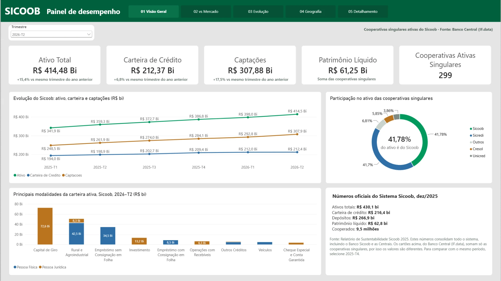

# Painel de cooperativas de crédito — Sicoob vs mercado

Painel em **Power BI** que analisa as cooperativas de crédito singulares do Brasil, com foco no Sicoob, usando apenas **dados públicos do Banco Central**. São 5 páginas: visão geral, comparação com os outros sistemas, evolução trimestral com juros e inflação, distribuição geográfica e detalhamento por cooperativa.

> **Aviso:** este é um estudo independente, feito com dados abertos. Não tem vínculo com o Sicoob nem com nenhum outro sistema cooperativo. Os números do painel somam as cooperativas **singulares** reportadas ao Banco Central e não substituem os balanços consolidados que cada sistema publica.



## Páginas

| Página | O que mostra |
|---|---|
| **01 Visão Geral** | Cartões do Sicoob (ativo, carteira, captações, patrimônio líquido, cooperativas ativas) com variação anual, evolução em 6 trimestres, participação no ativo das cooperativas singulares, carteira por modalidade e os números oficiais do sistema, com fonte. |
| **02 vs Mercado** | Ativo por sistema, participação na carteira (treemap), dispersão por cooperativa (ativo × Índice de Basileia, com a mediana) e tabela comparativa com ativo médio por cooperativa. |
| **03 Evolução** | Carteira do Sicoob por trimestre com variação anual, Selic e IPCA 12 meses, e a relação carteira ÷ captações. |
| **04 Geografia** | Carteira ativa por região do tomador, por sistema; cooperativas ativas por UF da sede; municípios-sede com mais cooperativas. |
| **05 Detalhamento** | Uma linha por cooperativa, com busca; ao clicar numa linha, cartão, evolução do ativo e carteira por modalidade daquela cooperativa. |

Capturas de todas as páginas em [`docs/img`](docs/img).

## Fontes de dados

Todas do Banco Central, consultadas direto pelas APIs públicas, sem dado digitado:

| Fonte | O que traz | Endereço |
|---|---|---|
| **IF.data** — cadastro | Cooperativas, tipo (singular/central), UF e município da sede | `olinda.bcb.gov.br/olinda/servico/IFDATA/versao/v1/odata/IfDataCadastro` |
| **IF.data** — relatório 1 (Resumo) | Ativo total, carteira de crédito, captações, patrimônio líquido, Índice de Basileia | `.../IfDataValores` |
| **IF.data** — relatório 9 | Carteira ativa por região do tomador | `.../IfDataValores` |
| **IF.data** — relatórios 11 e 13 | Carteira ativa de pessoa física e jurídica por modalidade | `.../IfDataValores` |
| **BcBase** | Nome fantasia e sigla das cooperativas (usados para identificar o sistema) | `olinda.bcb.gov.br/olinda/servico/BcBase/versao/v2/odata/Cooperativas` |
| **SGS** | Selic (1178), CDI (4389) e IPCA mensal (433) | `api.bcb.gov.br/dados/serie/bcdata.sgs.{código}/dados` |

Período: trimestres de **2025-T1 a 2026-T2** (IF.data) e **jan/2024 em diante** (SGS).

Os números oficiais citados na página 01 vêm do *Relatório de Sustentabilidade Sicoob 2025* e estão numa caixa de texto com a fonte, não em medidas.

## Metodologia

- **Só cooperativas singulares** (`Tcb = "B3S"`). As centrais ficam de fora porque o ativo delas é, em grande parte, dinheiro das singulares; somar as duas contaria o mesmo valor duas vezes.
- **Cooperativa ativa** = tem balanço reportado no trimestre de referência.
- **Sistema** identificado pelo nome: razão social → nome fantasia → sigla. Não existe campo oficial de vínculo nos dados abertos. A **Ailos** não é identificável pelo nome e fica em "Outros".
- **A partir de 2025-T1**: em 2025 o Banco Central mudou o layout dos relatórios (nova norma contábil) e a "Carteira de Crédito Classificada" virou "Carteira de Crédito". Misturar os dois períodos quebraria a série.
- **Saldos usam só o trimestre de referência** (o mais recente do filtro), nunca a soma de trimestres. O trimestre de referência é o do painel inteiro, não de cada grupo, para que cooperativas que pararam de reportar não apareçam com dados antigos.
- **Variação anual** compara com o mesmo trimestre do ano anterior; por isso existe a partir de 2026-T1.

## Conferências feitas

Valores do painel comparados com consultas diretas às APIs do Banco Central:

| Conferência | Esperado | No painel |
|---|---|---|
| Sicoob, 2025-T4: ativo / carteira / captações / PL (R$ bi) | 386,8 / 209,4 / 284,1 / 58,5 | ✔ |
| Cooperativas singulares ativas, 2026-T2 | Sicoob 299, total 710 | ✔ |
| Soma das cooperativas por UF, 2026-T2 | 710 | ✔ |
| Cooperativa CNPJ 00068987 (Sicoob Aracredi), 2025-T1: ativo / carteira / PL (R$ mi) e Basileia | 640 / 357 / 79 e 19,0% | ✔ |
| IPCA 12 meses (SGS 433): dez/24, dez/25, jun/26, set/26 | 4,83% / 4,26% / 4,64% / 4,58% | ✔ |
| Sicoob, 2026-T2: carteira ativa por região × por modalidade | Iguais, exceto exterior e região não informada | 199,77 × 199,80 bi ✔ |

## Limitações

- **Carteira ativa ≠ carteira de crédito.** Os relatórios por região e por modalidade usam o conceito de carteira ativa, diferente da "Carteira de Crédito" do Resumo.
- **Região e modalidade só no último trimestre** carregado.
- **Sem agências.** O gráfico por UF mostra a sede de cada cooperativa; os dados abertos usados não trazem os pontos de atendimento.
- **Índice de Basileia** é mostrado por cooperativa. A média entre cooperativas não representa o Basileia de um sistema.
- **Ailos dentro de "Outros"**, pelo motivo explicado acima.
- A API do IF.data é lenta (50 a 130 s por chamada) e às vezes fica fora do ar (erro 500). Nesse caso, a atualização deve ser repetida mais tarde.

## Como usar

**Abrir o painel pronto:** baixe `BI_Sicoob_v3.pbix` e abra no Power BI Desktop. Para atualizar os dados: *Página Inicial → Atualizar* (cerca de 10 a 15 minutos). As fontes usam credencial **Anônimo**.

**Recriar do zero:**
1. Em *Arquivo → Opções → Arquivo atual*: marque "Ignorar os Níveis de Privacidade" e desligue "Data/hora automática" e "Detectar automaticamente novas relações".
2. Crie cada consulta de [`powerquery/consultas.pq`](powerquery/consultas.pq) como Consulta Nula, pelo Editor Avançado, com o nome indicado em `NOME`.
3. Crie os relacionamentos, as medidas e as colunas de [`dax/medidas.dax`](dax/medidas.dax).

**Incluir um trimestre novo:** acrescente o código (ex.: `"202609"`) no fim da lista da consulta `Trimestres` e atualize.

## Estrutura

```
├── BI_Sicoob_v3.pbix          painel completo (Power BI Desktop)
├── powerquery/consultas.pq    15 consultas em M, com as regras comentadas
├── dax/medidas.dax            medidas, colunas calculadas e relacionamentos
└── docs/img/                  capturas das 5 páginas
```
